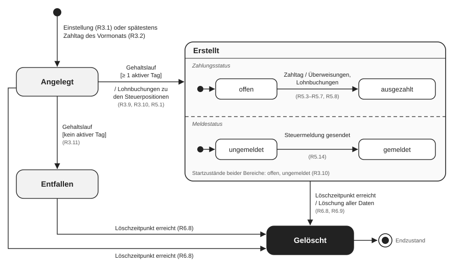

<!--
HINWEISE FÜR DIE ÜBERTRAGUNG IN TYPST
- Vollständiger Inhalt von "NGHR – Fachliche Regeln für die Gehaltsabrechnung", Stand 15.10.2026, ohne Kürzungen.
- Diese Datei ist der Markdown-Spiegel der Typst-Quellen unter chapters/. Beide müssen denselben Inhalt haben.
- Überschriften: # = Dokumenttitel, ## = Kapitel, ### = Abschnitt, #### = Unterabschnitt.
- Regeln: Format "**R<Kap>.<Nr>** Regeltext [Quelle → Verweis]". Jede Regel ist ein eigener Absatz.
- Erläuterungen sind NICHT normativ und im Original kursiv gesetzt. Hier: Zeilen, die mit "_Erläuterung:" beginnen.
- Nicht-normative Blöcke sind mit "(nicht normativ)" gekennzeichnet.
- In der Begriffstabelle sind Gruppenzeilen fett und haben leere Zellen (im Original sechs Einzeltabellen mit Zwischenüberschriften).
- " " in Tabellenzellen = Zeilenumbruch innerhalb der Zelle (in Typst `\` bzw. linebreak()).
- Kopf-/Fußzeile im Original: links "NGHR – Fachliche Regeln Gehaltsabrechnung · Gruppe 3", rechts "Stand 15.10.2026", unten "Seite X / Y".
-->

# NGHR – Fachliche Regeln für die Gehaltsabrechnung

Gruppe 3 · WWI-25-SEA · Software Engineering II (Oliver Theißen) · Diehl, Fischer, Mouait, Pollin, Roth, Schuessler · Stand 15.10.2026

Dieses Dokument legt fest, nach welchen fachlichen Regeln NGHR eine Gehaltsabrechnung anlegt, erstellt, auszahlt, meldet, zur Einsicht bereitstellt und löscht. Grundlage ist das Fallbeispiel NGHR. Die Spezifikation enthält nur, was das Fallbeispiel nennt. Wo der Wortlaut mehrere Lesarten zulässt, steht die gewählte Auslegung in Kapitel 7; wo eine Festlegung für die Umsetzung nötig ist, die das Fallbeispiel nicht trifft, steht sie dort als Annahme, die der Fachbereich bestätigen muss. Nicht geregelte Fälle stehen in Kapitel 7 als offene Punkte.

## Geltungsbereich und Konventionen

**Geltungsbereich:** Gehaltsabrechnungen für Inlandsmitarbeiter (R3.0) in allen drei Gehaltsklassen, vom Anlegen bis zur Löschung.

**Nicht Gegenstand:** Gehaltsabrechnungen für Mitarbeiter ohne Arbeitsvertrag in Deutschland; NGHR legt für sie keine Gehaltsabrechnung an (R3.0, SCH) · Gehaltsabrechnungen aus der Zeit vor NGHR, die in PZ verbleiben (SCH) · Pflege von Mitarbeiterdaten, Mitarbeiterstatus, Gehaltsdaten und Kostenstellen-Zuordnung; die Regeln verwenden diese Daten nur, die vorausgesetzten Eigenschaften stehen in Abschnitt 3.4 (HH, WW, PP) · Lohnkostenplan und Forecast, da sie auf Gehaltsdaten beruhen (PP) · Betriebsrenten (LL, PP) · künftige Bankanbindung über das ERP-System (BB, KK).

**Konventionen:** Regeln stehen im Indikativ Präsens aktiv, sind deklarativ und atomar. Die Begriffe aus Kapitel 1 werden unverändert verwendet. Erläuterungen (kursiv) sind nicht normativ. Beträge in Euro. In eckigen Klammern steht die Quelle:

| Kürzel | Quelle | Kürzel | Quelle |
|---|---|---|---|
| SCH | Schaffmeier | LL | Lässig |
| RR | Reich | II | Intim |
| BB | Baumeister | PP | Pinke |
| WW | Wuchtig | HH | Helfer |
| KK | Kohle | SK | Vorlesungsskript (F = Folie); nur methodische Quelle, nie Quelle einer Regel oder eines Begriffs |

„→ A_n_“ heißt: Die Regel beruht auf Auslegung oder Annahme _n_ (Kapitel 7.1). „→ O_n_“ verweist auf einen offenen Punkt (Kapitel 7.2).

## 1 Begriffe

Begriffe benennen die „Dinge“, auf die sich die Regeln beziehen. Alles, was sich ändern kann (Beträge, Termine, Rechenwege), steht nicht in der Definition, sondern in den Regeln. Erläuterungen sind nicht normativ.

| Begriff | Definition | Quelle |
|---|---|---|
| **Mitarbeiter und Gehaltsdaten** | | |
| Mitarbeiter | Ein Mitarbeiter ist eine Person bezogen auf genau einen Arbeitsvertrag, den die Sonnenschein AG mit ihr geschlossen hat. _Erläuterung: Ehemalige Mitarbeiter sind eingeschlossen. Stellt die Sonnenschein AG dieselbe Person erneut ein, ist sie ein neuer Mitarbeiter (R3.4)._ | LL, HH |
| Inlandsmitarbeiter | Ein Inlandsmitarbeiter ist ein Mitarbeiter mit Arbeitsvertrag in Deutschland. _Erläuterung: Entsendete Mitarbeiter sind Inlandsmitarbeiter (RR)._ | SCH, RR |
| Personalnummer | Die Personalnummer ist der Identifizierer eines Mitarbeiters in NGHR. | LL, BB |
| Einstellung | Die Einstellung ist die Erfassung eines Mitarbeiters in NGHR nach Abschluss seines Arbeitsvertrags. | LL, HH |
| Vertragsbeginn | Der Vertragsbeginn ist der im Arbeitsvertrag vereinbarte Tag des Arbeitsbeginns. | LL |
| Vertragsende | Das Vertragsende ist der letzte Tag, an dem der Arbeitsvertrag eines Mitarbeiters gilt. _Erläuterung: Nicht der Tag der Kündigung oder des Auflösungsvertrags._ | LL |
| Arbeitsverhältnis | Das Arbeitsverhältnis eines Mitarbeiters ist der Zeitraum von seinem Vertragsbeginn bis einschließlich seinem Vertragsende; ohne Vertragsende ist es unbefristet. | LL |
| Kündigung | Eine Kündigung ist eine Erklärung des Mitarbeiters oder der Sonnenschein AG, die den Arbeitsvertrag zu einem Vertragsende beendet. | LL |
| Auflösungsvertrag | Ein Auflösungsvertrag ist eine Vereinbarung zwischen Mitarbeiter und Sonnenschein AG, die den Arbeitsvertrag zu einem Vertragsende beendet. | LL |
| Sterbedatum | Das Sterbedatum ist der Tag, an dem ein Mitarbeiter verstorben ist. | LL, II |
| Mitarbeiterstatus | Der Mitarbeiterstatus ist ein Merkmal eines Mitarbeiters mit genau einem Wert je Kalendertag. _Erläuterung: Werte sind u. a. „aktiv“, „inaktiv“, „entsendet“, „Rentner“._ | LL, RR |
| Aktiver Tag | Ein aktiver Tag ist ein Kalendertag, an dem der Mitarbeiterstatus eines Mitarbeiters „aktiv“ ist. | LL, RR |
| Manager-Kennzeichen | Das Manager-Kennzeichen ist ein Merkmal eines Mitarbeiters in NGHR, das anzeigt, ob er Manager ist. | HH |
| Manager | Ein Manager ist ein Mitarbeiter, für den in NGHR das Manager-Kennzeichen gesetzt ist. | HH, PP |
| Kostenstelle | Eine Kostenstelle ist eine im ERP-System geführte Organisationseinheit, der Mitarbeiter tagesgenau zugeordnet sind. | PP |
| Bankverbindung | Die Bankverbindung ist das Konto, das in NGHR für Zahlungen an einen Mitarbeiter hinterlegt ist. | HH |
| Steuer-ID | Die Steuer-ID (Steueridentifikationsnummer) ist der Identifizierer, unter dem das Betriebsfinanzamt einen Mitarbeiter führt. | KK |
| Gehaltsklasse | Die Gehaltsklasse ist ein im Arbeitsvertrag vereinbartes Merkmal eines Mitarbeiters, das festlegt, aus welchen Bruttopositionen sein Bruttogehalt besteht. _Erläuterung: Werte: „Gehalt“, „Gehalt und Provision“, „Gehalt und Bonus“._ | WW |
| Monatsgehalt | Das Monatsgehalt ist der im Arbeitsvertrag vereinbarte monatliche Bruttobetrag eines Mitarbeiters. _Erläuterung: Bei WW „monatliches Bruttogehalt“; nicht zu verwechseln mit dem Bruttogehalt einer Gehaltsabrechnung._ | WW |
| Gehaltsdaten | Die Gehaltsdaten eines Mitarbeiters sind seine Gehaltsklasse und sein Monatsgehalt. _Erläuterung: Zur weiteren Lesart bei II siehe A13._ | WW → A13 |
| Vertriebsmitarbeiter | Ein Vertriebsmitarbeiter ist ein Mitarbeiter mit der Gehaltsklasse „Gehalt und Provision“. _Erläuterung: NGHR kennt keine Organisationsdaten (PP); Vertriebsmitarbeiter sind daher nur über die Gehaltsklasse bestimmbar._ | WW, PP |
| **Provision und Bonus** | | |
| Kundenvertrag | Ein Kundenvertrag ist ein Vertrag, den ein Vertriebsmitarbeiter mit einem Kunden abgeschlossen hat und den das CRM-System führt. | RR, WW |
| Abschlussdatum | Das Abschlussdatum ist der Tag, an dem ein Kundenvertrag abgeschlossen wurde. | WW |
| Vertragsvolumen | Das Vertragsvolumen ist der Gesamtwert eines Kundenvertrags laut CRM-System. | WW, RR |
| Provisionszeitraum | Der Provisionszeitraum eines Abrechnungsmonats ist der Zeitraum, aus dem Kundenverträge in die Provision dieses Abrechnungsmonats eingehen (R4.4). | WW |
| Bonusjahr | Ein Bonusjahr ist ein Kalenderjahr, für das die Geschäftsführung einen Bonussatz festlegt. | WW |
| Bonussatz | Ein Bonussatz ist ein Prozentsatz des Monatsgehalts, der den Bonus für ein Bonusjahr bestimmt. | WW, RR |
| **Gehaltsabrechnung und Gehaltspositionen** | | |
| Abrechnungsmonat | Der Abrechnungsmonat ist der Kalendermonat, für den eine Gehaltsabrechnung gilt. | KK |
| Gehaltsabrechnung | Eine Gehaltsabrechnung ist eine Aufstellung der Gehaltspositionen eines Mitarbeiters für einen Abrechnungsmonat. | WW |
| Gehaltsposition | Eine Gehaltsposition ist ein benannter Betrag einer Gehaltsabrechnung. | WW |
| Bruttoposition | Eine Bruttoposition ist eine Gehaltsposition, die eine Vergütung vor Abzügen ausweist. _Erläuterung: Welche Bruttopositionen es gibt, legt R4.0 fest._ | WW, RR |
| Grundgehalt | Das Grundgehalt ist die Bruttoposition, die den auf den Abrechnungsmonat entfallenden Teil des Monatsgehalts ausweist. _Erläuterung: Nicht zu verwechseln mit der Gehaltsklasse „Gehalt“._ | WW |
| Provision | Die Provision ist die Bruttoposition, die einen Vertriebsmitarbeiter am Vertragsvolumen seiner Kundenverträge beteiligt. | WW |
| Bonus | Der Bonus ist die Bruttoposition, die die jährliche Zahlung an einen Mitarbeiter der Gehaltsklasse „Gehalt und Bonus“ ausweist. | WW, RR |
| Bruttogehalt | Das Bruttogehalt ist die Gehaltsposition mit der gesamten Vergütung einer Gehaltsabrechnung vor Abzügen. | WW |
| Steuerart | Eine Steuerart ist eine Abgabe an das Betriebsfinanzamt, die vom Bruttogehalt abgezogen wird. _Erläuterung: Welche Steuerarten es gibt, legt R4.12a fest._ | KK |
| Steuerposition | Eine Steuerposition ist eine Gehaltsposition, die den Betrag einer Steuerart ausweist. | WW, KK |
| Nettogehalt | Das Nettogehalt ist die Gehaltsposition mit der Vergütung nach Abzug der Steuerpositionen. | WW |
| Versicherungsart | Eine Versicherungsart ist eine Sozialversicherung, zu der vom Bruttogehalt einer Gehaltsabrechnung ein Beitrag zu zahlen ist. _Erläuterung: Welche Versicherungsarten es gibt, legt R4.17a fest._ | WW |
| SV-Beitrag | Ein SV-Beitrag ist eine Gehaltsposition mit dem gesamten Beitrag zu einer Versicherungsart. | WW |
| Arbeitgeberanteil | Ein Arbeitgeberanteil ist eine Gehaltsposition mit dem Teil eines SV-Beitrags, den die Sonnenschein AG trägt. | WW |
| Auszahlungsbetrag | Der Auszahlungsbetrag ist die Gehaltsposition mit dem Betrag, den der Mitarbeiter mit einer Gehaltsabrechnung erhält. | WW |
| **Jahreswerte für Steuer und Sozialversicherung** | | |
| Frühere Gehaltsabrechnung | Eine frühere Gehaltsabrechnung ist eine erstellte Gehaltsabrechnung desselben Mitarbeiters mit früherem Abrechnungsmonat im selben Kalenderjahr. _Erläuterung: Angelegte und entfallene Gehaltsabrechnungen gehen damit in keine Summe ein._ | KK, WW |
| Kumuliertes Bruttogehalt | Das kumulierte Bruttogehalt ist die Summe der Bruttogehälter einer Gehaltsabrechnung und aller ihrer früheren Gehaltsabrechnungen. | KK, WW |
| Kumulierte ESt | Die kumulierte ESt ist die Einkommensteuer auf das kumulierte Bruttogehalt einer Gehaltsabrechnung (R4.13). | KK |
| Kumulierter Soli | Der kumulierte Soli ist der Solidaritätszuschlag auf die kumulierte ESt einer Gehaltsabrechnung (R4.15). | KK |
| Jahresbruttogehalt | Das Jahresbruttogehalt ist die Summe der Bruttogehälter aller erstellten Gehaltsabrechnungen eines Mitarbeiters in einem Kalenderjahr. | KK, WW |
| Grundfreibetrag | Der Grundfreibetrag ist der Teil des Jahresbruttogehalts, der keiner Einkommensteuer unterliegt. | KK |
| Beitragsbemessungsgrenze (BBM) | Die BBM ist das Jahresbruttogehalt, bis zu dem für eine Versicherungsart Beiträge anfallen. | WW |
| Beitragspflichtiger Betrag | Der beitragspflichtige Betrag ist der Teil des Bruttogehalts einer Gehaltsabrechnung, auf den für eine Versicherungsart Beiträge anfallen. | WW |
| **Abläufe und Termine** | | |
| Einführungsmonat | Der Einführungsmonat einer Gehaltsklasse ist der erste Abrechnungsmonat, für den die Gehaltsabrechnungen der Mitarbeiter dieser Gehaltsklasse in NGHR statt in PZ geführt werden. | SCH → A14 |
| Gehaltslauf | Ein Gehaltslauf ist eine Verarbeitung in NGHR, die angelegte Gehaltsabrechnungen eines Abrechnungsmonats erstellt oder als entfallen kennzeichnet. Der Gehaltslauf einer Gehaltsabrechnung ist der Gehaltslauf ihres Abrechnungsmonats. | RR |
| Wochentag | Ein Wochentag ist ein Kalendertag von Montag bis Freitag. | WW → A9 |
| Zahltag | Der Zahltag ist der Kalendertag, an dem die Auszahlungsbeträge der Gehaltsabrechnungen eines Abrechnungsmonats fällig sind. | WW, BB |
| Überweisung | Eine Überweisung ist eine Zahlung vom Konto der Sonnenschein AG bei der Hausbank an einen Empfänger. | KK, BB |
| Zahlungsabfluss | Ein Zahlungsabfluss ist eine Überweisung, die NGHR für eine Gehaltsabrechnung auslöst. | KK, PP |
| Lohnbuch | Das Lohnbuch ist das Buch im ERP-System, in dem die Buchhaltung Zahlungsabflüsse und Steuern je Mitarbeiter verbucht. | KK |
| Lohnbuchung | Eine Lohnbuchung ist ein Datensatz zu einem Zahlungsabfluss oder zu einer Steuerposition, den NGHR dem ERP-System zur Verbuchung im Lohnbuch meldet. | KK, PP |
| Meldequartal | Das Meldequartal einer Gehaltsabrechnung ist das Kalenderquartal, in dem ihr Abrechnungsmonat liegt. | KK |
| Quartalsbruttoeinkommen | Das Quartalsbruttoeinkommen ist die Summe der Bruttogehälter der Gehaltsabrechnungen eines Mitarbeiters mit demselben Meldequartal, die eine Steuermeldung berücksichtigt. _Erläuterung: Bei KK „Bruttoeinkommen“._ | KK |
| Steuermeldung | Eine Steuermeldung ist eine elektronische Meldung per Elster an das Betriebsfinanzamt, die Quartalsbruttoeinkommen je Mitarbeiter übermittelt. | KK |
| Löschzeitpunkt | Der Löschzeitpunkt eines Mitarbeiters ist der Tag, an dem NGHR alle Daten dieses Mitarbeiters löscht (R6.7). | II |
| **Systeme und Beteiligte** | | |
| Geschäftsführung | Die Geschäftsführung ist die Unternehmensleitung der Sonnenschein AG. | WW, PP |
| PZ | PZ („Personal Zentral“) ist das bestehende IT-System für das Personalwesen, das NGHR ablöst. | SCH |
| ERP-System | Das ERP-System ist das System für Controlling und Buchhaltung, das Kostenstellen und Lohnbuch führt. | BB, PP, KK |
| CRM-System | Das CRM-System ist das System, das die Kundenverträge führt. | RR |
| Vertragsschnittstelle | Die Vertragsschnittstelle ist die Schnittstelle des CRM-Systems, über die andere Systeme Kundenverträge abrufen. | RR |
| Hausbank | Die Hausbank ist die Bank, bei der die Sonnenschein AG das Konto führt, von dem NGHR Überweisungen auslöst. | KK, BB |
| Betriebsfinanzamt | Das Betriebsfinanzamt ist die Finanzbehörde, die die Steuern auf die Gehälter der Sonnenschein AG einzieht. | KK |
| Elster | Elster ist das elektronische Verfahren, über das NGHR Steuermeldungen an das Betriebsfinanzamt übermittelt. | KK |
| I&B | I&B ist der zentrale Identity-Provider der Sonnenschein AG. | BB |
| User | Ein User ist ein Benutzerkonto in I&B, das aktiv oder inaktiv ist. | BB |
| Anwender | Ein Anwender ist eine Person mit einem User. _Erläuterung: Mitarbeiter und externe Recruiter (HH)._ | BB, HH |
| Rolle | Eine Rolle ist eine Berechtigungsgruppe, die I&B einem Anwender zuordnet. _Erläuterung: NGHR bezieht aus I&B die Rollen Mitarbeiter, Manager, Personalwesen, Lohnbuchhaltung und Recruiting (R6.4)._ | BB |
| Employee Self-Service (ESS) | Die ESS ist die Benutzerschnittstelle von NGHR, in der ein Mitarbeiter seine eigenen Daten und Gehaltsabrechnungen einsieht. | BB |

## 2 Zustände der Gehaltsabrechnung

Eine Gehaltsabrechnung befindet sich zu jedem Zeitpunkt in genau einem Zustand. Im Zustand „Erstellt“ hat sie zusätzlich die beiden voneinander unabhängigen Merkmale Zahlungsstatus und Meldestatus.

| Zustand / Merkmal | Bedeutung | Regeln |
|---|---|---|
| Angelegt | Die Gehaltsabrechnung existiert für Mitarbeiter und Abrechnungsmonat, enthält aber noch keine Gehaltspositionen (Anfangszustand). | R3.1, R3.2 |
| Erstellt | Alle Gehaltspositionen sind berechnet; der Inhalt ist endgültig. | R3.9, R3.10, R3.12 |
| – Zahlungsstatus | „offen“: Die Überweisungen nach R5.3 und R5.4 sind noch nicht ausgelöst. „ausgezahlt“: Sie sind ausgelöst. | R5.7 |
| – Meldestatus | „ungemeldet“: Das Bruttogehalt ist in keiner Steuermeldung berücksichtigt. „gemeldet“: Es ist in einer Steuermeldung berücksichtigt. | R5.12, R5.14 |
| Entfallen | Der Mitarbeiter hat im Abrechnungsmonat keinen aktiven Tag. Die Gehaltsabrechnung bleibt ohne Gehaltspositionen; NGHR zahlt nichts. Ob der Mitarbeiter in der Steuermeldung erscheint, ist offen (O22). | R3.11 |
| Gelöscht | Die Gehaltsabrechnung ist mit allen Daten des Mitarbeiters gelöscht (Endzustand). | R6.8, R6.9 |

### Zustandsübergänge

Der Zustandsautomat zeigt jeden Übergang mit dem auslösenden Ereignis, der Bedingung in eckigen Klammern und der ausgelösten Aktion hinter dem Schrägstrich. Das Vorlesungsskript lässt eine Tabelle als Ergänzung oder Alternative zu; dieses Dokument führt die Übergänge nur als Automaten, die zugehörigen Regeln stehen in Kapitel 3, 5 und 6.

_Abbildung 1 — Zustandsautomat der Gehaltsabrechnung. Das Ereignis „Gehaltslauf“ meint stets den Gehaltslauf des Abrechnungsmonats der Gehaltsabrechnung (R3.9, R3.11); für jeden Übergang nach „Gelöscht“ gelten R6.8 und R6.9._

## 3 Erstellen: Anlegen und Gehaltslauf

### 3.1 Anlegen

**R3.0** NGHR darf Gehaltsabrechnungen nur für Inlandsmitarbeiter anlegen. [SCH, RR → O19]

**R3.1** Folgendes gilt, sobald die Einstellung eines Inlandsmitarbeiters erfolgt ist: Seine Gehaltsabrechnung für den späteren der beiden folgenden Abrechnungsmonate ist im Zustand „Angelegt“: (1) Abrechnungsmonat seines Vertragsbeginns, (2) Einführungsmonat seiner Gehaltsklasse. [→ A10, A14, A22]

**R3.2** Für jeden Abrechnungsmonat eines Inlandsmitarbeiters, der auf den späteren der beiden Abrechnungsmonate (1) Abrechnungsmonat seines Vertragsbeginns, (2) Einführungsmonat seiner Gehaltsklasse folgt und in dem sein Arbeitsverhältnis an mindestens einem Kalendertag besteht, ist spätestens am Zahltag des Vormonats eine Gehaltsabrechnung im Zustand „Angelegt“. [WW → A10]

_Erläuterung: Der spätere der beiden Abrechnungsmonate ist durch R3.1 abgedeckt; Abrechnungsmonate davor bleiben in PZ (R3.5). Liegt ein angelegter Abrechnungsmonat nach einer Änderung außerhalb des Arbeitsverhältnisses, entfällt die Gehaltsabrechnung im Gehaltslauf (R3.11)._

**R3.3** Für jeden Mitarbeiter existiert je Abrechnungsmonat höchstens eine Gehaltsabrechnung. [WW]

**R3.4** Jede Gehaltsabrechnung gehört zu genau einem Mitarbeiter. [WW, LL]

_Erläuterung: Stellt die Sonnenschein AG dieselbe Person erneut ein, ist sie ein neuer Mitarbeiter mit neuer Personalnummer; ihre früheren Gehaltsabrechnungen bleiben beim früheren Mitarbeiter (LL)._

**R3.5** NGHR legt für keinen Mitarbeiter eine Gehaltsabrechnung für einen Abrechnungsmonat vor dem Einführungsmonat seiner Gehaltsklasse an. [SCH → A14]

_Erläuterung: Gehaltsabrechnungen früherer Abrechnungsmonate verbleiben in PZ (SCH)._

### 3.2 Gehaltslauf

**R3.6a** NGHR führt für jeden Abrechnungsmonat genau einen Gehaltslauf durch. [RR → A17, O6]

**R3.6b** Der Gehaltslauf eines Abrechnungsmonats findet frühestens am 16. dieses Abrechnungsmonats statt. [WW → A4]

**R3.6c** Der Gehaltslauf eines Abrechnungsmonats findet spätestens am Kalendertag vor seinem Zahltag statt. [RR, SCH → A4]

**R3.7** NGHR ruft vor jedem Gehaltslauf die Kundenverträge über die Vertragsschnittstelle ab. [RR]

**R3.8** Die Provisionen eines Gehaltslaufs beruhen auf den Kundenverträgen aus dem Abruf vor diesem Gehaltslauf. [RR → O7]

### 3.3 Erstellt oder entfallen

**R3.9** Im Gehaltslauf eines Abrechnungsmonats erstellt NGHR jede angelegte Gehaltsabrechnung dieses Abrechnungsmonats, deren Mitarbeiter in diesem Abrechnungsmonat mindestens einen aktiven Tag hat. [RR, WW]

**R3.10** Eine Gehaltsabrechnung ist nach ihrer Erstellung im Zustand „Erstellt“ mit Zahlungsstatus „offen“ und Meldestatus „ungemeldet“. [RR, WW]

**R3.11** Eine angelegte Gehaltsabrechnung, deren Mitarbeiter in ihrem Abrechnungsmonat keinen aktiven Tag hat, ist nach dem Gehaltslauf ihres Abrechnungsmonats im Zustand „Entfallen“. [RR, LL]

_Erläuterung: Betrifft entsendete Mitarbeiter (die ausländische Tochtergesellschaft zahlt, RR) und inaktive Mitarbeiter (Sabbatical, Freistellung, längere Krankheit, LL)._

**R3.12** Der Inhalt einer Gehaltsabrechnung im Zustand „Erstellt“ ändert sich nicht. [→ A16, O3]

### 3.4 Eingangsdaten

Die Pflege von Mitarbeiterstatus, Gehaltsdaten und Kostenstellen-Zuordnung ist nicht Gegenstand dieses Dokuments. Die Regeln R3.13 bis R3.16 legen fest, welche Eigenschaften dieser Daten die Gehaltsabrechnung voraussetzt; R3.17 bis R3.20 legen fest, welcher Datenstand gilt.

**R3.13** An Kalendertagen außerhalb seines Arbeitsverhältnisses ist der Mitarbeiterstatus eines Mitarbeiters nicht „aktiv“. [LL]

**R3.14** Kündigung und Auflösungsvertrag ändern den Mitarbeiterstatus nicht. [LL]

_Erläuterung: Eine Kündigung oder ein Auflösungsvertrag allein führt daher nicht dazu, dass eine Gehaltsabrechnung vor dem Vertragsende entfällt._

**R3.15** Jeder Mitarbeiter ist genau einer Gehaltsklasse zugeordnet. [WW]

**R3.16** Jeder Manager ist der Gehaltsklasse „Gehalt und Bonus“ zugeordnet, auch wenn er im Vertrieb arbeitet. [WW → O18]

_Erläuterung: Ein Manager im Vertrieb erhält daher keine Provision._

**R3.17** Die Gehaltsdaten einer Gehaltsabrechnung sind die Gehaltsdaten, die zu Beginn ihres Gehaltslaufs in NGHR hinterlegt sind. [WW → A2]

**R3.18** Der Mitarbeiterstatus einer Gehaltsabrechnung ist für jeden Kalendertag ihres Abrechnungsmonats der Wert, der zu Beginn ihres Gehaltslaufs in NGHR für diesen Kalendertag hinterlegt ist. [RR, LL → A2]

_Erläuterung: Das gilt auch für die Kalendertage nach dem Gehaltslauf._

**R3.19** Die Kostenstelle einer Gehaltsabrechnung ist die Kostenstelle, der der Mitarbeiter zu Beginn ihres Gehaltslaufs zugeordnet ist. [PP → A3, O4]

**R3.20** NGHR übernimmt die Zuordnung der Mitarbeiter zu Kostenstellen aus dem ERP-System. [PP]

## 4 Erstellen: Inhalt der Gehaltsabrechnung

NGHR bildet das Bruttogehalt, zieht die Steuern ab (Nettogehalt), zieht die vollen SV-Beiträge ab und rechnet die Arbeitgeberanteile wieder hinzu (Auszahlungsbetrag) (WW). Grundfreibetrag, Soli-Schwelle und BBM sind Jahreswerte; deshalb rechnet NGHR jeden Monat auf Basis des im Kalenderjahr bisher Verdienten (→ A7, A8).

### 4.1 Bruttopositionen und Bruttogehalt

**R4.0** Die Bruttopositionen einer Gehaltsabrechnung sind Grundgehalt, Provision und Bonus. [WW, RR]

_Erläuterung: Welche dieser Bruttopositionen eine erstellte Gehaltsabrechnung enthält, legen R4.1, R4.3 und R4.7 fest._

**R4.1** Jede erstellte Gehaltsabrechnung enthält die Bruttoposition „Grundgehalt“. [WW]

**R4.2** Das Grundgehalt beträgt Monatsgehalt × Anzahl der aktiven Tage im Abrechnungsmonat ÷ Anzahl der Kalendertage des Abrechnungsmonats. [WW, LL → A1]

**R4.3** Eine erstellte Gehaltsabrechnung enthält die Bruttoposition „Provision“ genau dann, wenn ihre Gehaltsklasse „Gehalt und Provision“ ist. [WW]

**R4.4** Der Provisionszeitraum eines Abrechnungsmonats beginnt am 16. des Vormonats und endet einschließlich am 15. des Abrechnungsmonats. [WW → A5]

_Erläuterung: Für März: 16.02. bis 15.03. Ein Kundenvertrag vom 15.02. zählt für Februar, einer vom 16.03. für April._

**R4.5** Die Provision beträgt 3 % der Summe der Vertragsvolumen aller Kundenverträge des Mitarbeiters der Gehaltsabrechnung, deren Abschlussdatum im Provisionszeitraum liegt; ohne solche Kundenverträge beträgt sie 0 €. [WW]

**R4.6** NGHR kürzt die Provision nicht nach aktiven Tagen. [→ A1]

**R4.7** Eine erstellte Gehaltsabrechnung enthält die Bruttoposition „Bonus“ genau dann, wenn ihre Gehaltsklasse „Gehalt und Bonus“ und ihr Abrechnungsmonat ein Mai ist. [WW → O20]

**R4.8** Der Bonus beträgt Bonussatz des Vorjahres × Monatsgehalt der Gehaltsabrechnung. [WW → A6, O5]

**R4.9** Die Geschäftsführung legt zu Jahresbeginn genau einen Bonussatz für das vorangegangene Bonusjahr fest. [WW]

**R4.10** Der Bonussatz eines Bonusjahres gilt für alle Mitarbeiter der Gehaltsklasse „Gehalt und Bonus“. [WW, RR]

**R4.11** Anwender mit der Rolle Lohnbuchhaltung erfassen den Bonussatz einmal im Jahr in NGHR. [RR → A20]

**R4.12** Das Bruttogehalt ist die Summe aller Bruttopositionen der Gehaltsabrechnung. [WW, RR]

### 4.2 Steuerpositionen und Nettogehalt

**R4.12a** Die Steuerarten sind die Einkommensteuer (ESt) und der Solidaritätszuschlag (Soli). [KK]

**R4.13** Die kumulierte ESt einer Gehaltsabrechnung beträgt 25 % des Betrags, um den ihr kumuliertes Bruttogehalt den Grundfreibetrag von 16.000 € übersteigt, mindestens 0 €. [KK → A7]

**R4.14** Die Steuerposition „Einkommensteuer“ beträgt die kumulierte ESt abzüglich der Einkommensteuer aller früheren Gehaltsabrechnungen. [KK → A7]

**R4.15** Der kumulierte Soli einer Gehaltsabrechnung beträgt 5,5 % ihrer kumulierten ESt, sofern diese mindestens 18.000 € beträgt; andernfalls 0 €. [KK → A7]

**R4.16** Die Steuerposition „Solidaritätszuschlag“ beträgt der kumulierte Soli abzüglich des Solidaritätszuschlags aller früheren Gehaltsabrechnungen. [KK → A7]

**R4.17** Das Nettogehalt ist das Bruttogehalt abzüglich Einkommensteuer und Solidaritätszuschlag. [WW]

### 4.3 SV-Beiträge, Arbeitgeberanteile und Auszahlungsbetrag

**R4.17a** Die Versicherungsarten sind die Krankenversicherung (KV), die Pflegeversicherung (PV), die Arbeitslosenversicherung (AV) und die Rentenversicherung (RV). [WW]

Für die Versicherungsarten gelten folgende Beitragssätze und BBM: [WW]

| | KV | PV | AV | RV |
|---|---|---|---|---|
| Beitragssatz | 14 % | 4,5 % | 5 % | 21 % |
| BBM (Jahresbruttogehalt) | 63.000 € | 63.000 € | 94.000 € | 94.000 € |

**R4.18** Der beitragspflichtige Betrag einer Gehaltsabrechnung für eine Versicherungsart ist der Teil ihres Bruttogehalts, der zusammen mit den Bruttogehältern aller früheren Gehaltsabrechnungen die BBM dieser Versicherungsart nicht übersteigt. [WW → A8]

**R4.19** Der SV-Beitrag einer Versicherungsart beträgt Beitragssatz × beitragspflichtiger Betrag. [WW]

**R4.20** Der Arbeitgeberanteil einer Versicherungsart beträgt die Hälfte des SV-Beitrags derselben Versicherungsart. [WW]

**R4.21** Der Auszahlungsbetrag ist das Nettogehalt abzüglich aller SV-Beiträge zuzüglich aller Arbeitgeberanteile. [WW]

**R4.22** Eine erstellte Gehaltsabrechnung enthält ihre Gehaltspositionen in dieser Reihenfolge: Grundgehalt, Provision, Bonus (soweit vorhanden) · Bruttogehalt · Einkommensteuer, Solidaritätszuschlag · Nettogehalt · SV-Beiträge KV, PV, AV, RV · Arbeitgeberanteile KV, PV, AV, RV · Auszahlungsbetrag. [WW → A21]

#### Zusammengefasst (nicht normativ)

_„Frühere GA“ = frühere Gehaltsabrechnungen im Sinne von Kapitel 1. Die Rundung regelt das Fallbeispiel nicht (O1)._

| Größe | Berechnung |
|---|---|
| kum. Bruttogehalt | Bruttogehalt + Σ Bruttogehalt der früheren GA |
| Einkommensteuer | 0,25 × max(0; kum. Bruttogehalt − 16.000) − Σ ESt der früheren GA |
| Solidaritätszuschlag | (0,055 × kum. ESt, falls kum. ESt ≥ 18.000, sonst 0) − Σ Soli der früheren GA |
| SV-Beitrag(v) | Beitragssatz(v) × min(Bruttogehalt; max(0; BBM(v) − Σ Brutto der früheren GA)) |
| Auszahlungsbetrag | Bruttogehalt − ESt − Soli − Σ SV-Beitrag + Σ SV-Beitrag ÷ 2 |

## 5 Abarbeiten: Zahlung und Meldungen

### 5.1 Lohnbuchungen zu den Steuern

**R5.1** Folgendes gilt, sobald eine Gehaltsabrechnung im Zustand „Erstellt“ ist: Für jede ihrer Steuerpositionen über 0 € existiert eine Lohnbuchung mit Buchungsdatum = Tag des Gehaltslaufs, Betrag, Personalnummer, Kostenstelle der Gehaltsabrechnung, Zweck = Steuerart, Abrechnungsmonat und Steuer-ID. [KK, PP → A11, A19]

### 5.2 Auszahlung

**R5.2** Der Zahltag eines Abrechnungsmonats ist der letzte Wochentag dieses Abrechnungsmonats. [WW → A9, O2]

_Erläuterung: Oktober 2026: 31.10. ist ein Samstag, Zahltag ist Freitag, 30.10.2026._

**R5.3** NGHR überweist am Zahltag für jede erstellte Gehaltsabrechnung den Auszahlungsbetrag an die Bankverbindung des Mitarbeiters, sofern der Auszahlungsbetrag über 0 € liegt. [KK, WW, HH → O10, O12]

**R5.4** NGHR überweist am Zahltag für jede erstellte Gehaltsabrechnung jeden ihrer SV-Beiträge über 0 €. [KK → A15, O11]

**R5.5** NGHR löst alle Überweisungen über die direkte Anbindung an das Konto bei der Hausbank aus. [KK, BB]

**R5.6** NGHR überweist keine Steuern. [KK]

_Erläuterung: Das Betriebsfinanzamt zieht die Steuern auf Grundlage der Steuermeldungen per Lastschrift ein._

**R5.7** Am Zahltag ihres Abrechnungsmonats wechselt der Zahlungsstatus einer erstellten Gehaltsabrechnung auf „ausgezahlt“, sobald NGHR alle Überweisungen nach R5.3 und R5.4 für sie ausgelöst hat. [KK → O12]

### 5.3 Lohnbuchungen zu den Zahlungsabflüssen und Meldung an das ERP-System

**R5.8** Für jeden Zahlungsabfluss existiert eine Lohnbuchung mit Buchungsdatum = Tag der Überweisung, Betrag, Personalnummer, Kostenstelle der Gehaltsabrechnung, Zweck = „ausgezahltes Gehalt“ oder die Versicherungsart des SV-Beitrags, und Abrechnungsmonat. [KK, PP]

**R5.9** NGHR meldet dem ERP-System alle Lohnbuchungen mit demselben Buchungsdatum gemeinsam in genau einer Meldung an diesem Buchungsdatum. [KK → A11]

**R5.10** Jede Lohnbuchung ist dem ERP-System genau einmal gemeldet. [KK]

### 5.4 Steuermeldung an das Betriebsfinanzamt

**R5.11** NGHR sendet für jedes Meldequartal spätestens am 10. Tag nach Quartalsende (10.04., 10.07., 10.10., 10.01.) eine Steuermeldung per Elster an das Betriebsfinanzamt. [KK]

**R5.12** Eine Steuermeldung berücksichtigt jede erstellte Gehaltsabrechnung mit Meldestatus „ungemeldet“, deren Meldequartal abgeschlossen ist, unabhängig vom Zahlungsstatus. [KK → A11]

**R5.13** Eine Steuermeldung weist je Mitarbeiter und Meldequartal die Steuer-ID und das Quartalsbruttoeinkommen aus. [KK → A18, O22]

**R5.14** Sobald eine Steuermeldung gesendet ist, ist der Meldestatus jeder darin berücksichtigten Gehaltsabrechnung „gemeldet“. [KK]

## 6 Abarbeiten: Einsicht und Löschung

### 6.1 Einsicht

**R6.1** NGHR gewährt Einsicht in erstellte Gehaltsabrechnungen ausschließlich
(1) Anwendern mit der Rolle Lohnbuchhaltung in die Gehaltsabrechnungen aller Mitarbeiter, auch ehemaliger, und
(2) einem Mitarbeiter in der ESS in seine eigenen Gehaltsabrechnungen ab dem Zahltag ihres Abrechnungsmonats. [II, BB, RR]

_Erläuterung: Keine Einsicht haben insbesondere: der Manager in die Gehaltsabrechnungen seiner Mitarbeiter (II), Anwender mit der Rolle Personalwesen ohne die Rolle Lohnbuchhaltung (II), Anwender mit der Rolle Recruiting (HH) und jeder Mitarbeiter in fremde Gehaltsabrechnungen (II). Angelegte und entfallene Gehaltsabrechnungen haben keine Gehaltspositionen._

**R6.2** Der Zugang zur ESS setzt einen aktiven User voraus. [BB]

**R6.3** Der User eines Mitarbeiters ist von seinem Vertragsbeginn bis zu seinem Vertragsende aktiv. [BB]

_Erläuterung: Ehemalige Mitarbeiter sehen ihre Gehaltsabrechnungen daher nicht in der ESS (O15)._

**R6.4** NGHR bezieht die Rollen der Anwender aus I&B. [BB]

**R6.5** NGHR pflegt keine Rollen. [BB]

**R6.6** NGHR sperrt keine Gehaltsabrechnungen; sie bleiben bis zur Löschung nach R6.1 einsehbar. [II]

### 6.2 Löschung

**R6.7** Der Löschzeitpunkt eines Mitarbeiters ist der spätere der beiden Tage
(1) fünf Jahre nach seinem Sterbedatum,
(2) zehn Jahre nach dem Tag der letzten Überweisung eines Auszahlungsbetrags an ihn. [II → A12, O16, O21]

**R6.8** Am Löschzeitpunkt eines Mitarbeiters löscht NGHR alle seine Gehaltsabrechnungen unabhängig von ihrem Zustand zusammen mit allen anderen Daten dieses Mitarbeiters. [II]

**R6.9** Eine nach R6.8 gelöschte Gehaltsabrechnung ist im Zustand „Gelöscht“; kein Anwendungsfall löst danach noch etwas an ihr aus. [II]

## 7 Auslegungen, Annahmen und offene Punkte

Die Spezifikation enthält nur, was das Fallbeispiel nennt. Auslegungen legen fest, wie eine genannte Anforderung gemeint ist, wenn der Wortlaut mehrere Lesarten zulässt. Annahmen sind Festlegungen der Gruppe, die für die Umsetzung nötig sind, die das Fallbeispiel aber nicht trifft; der Fachbereich muss sie bestätigen. Offene Punkte sind Fälle, die das Fallbeispiel nicht regelt; dafür enthält die Spezifikation bewusst keine Regel (SK F54: nicht mit Alltagswissen ergänzen).

### 7.1 Auslegungen und Annahmen

| Nr. | Art | Auslegung bzw. Annahme und Grundlage | Regeln |
|---|---|---|---|
| A1 | Annahme | Teilmonat: Das Grundgehalt wird anteilig nach aktiven Kalendertagen berechnet, Provision und Bonus ungekürzt. Grundlage: Gehalt erhalten nur aktive Mitarbeiter (RR, WW); Vertragsbeginn und -ende können mitten im Monat liegen (LL). Das Fallbeispiel nennt kein Verfahren; Arbeitstage oder ein 30-Tage-Monat wären ebenfalls denkbar. Mit der Lohnbuchhaltung zu bestätigen. | R4.2, R4.6 |
| A2 | Auslegung | Maßgeblich ist der Datenstand zu Beginn des Gehaltslaufs, auch für die restlichen Kalendertage des Abrechnungsmonats. Grundlage: Der Gehaltslauf findet vor Monatsende statt (R3.6c). | R3.17, R3.18, R3.19 |
| A3 | Annahme | Die Kostenstelle einer Gehaltsabrechnung ist die Kostenstelle zu Beginn des Gehaltslaufs. Grundlage: PP ordnet tagesgenau zu, die Lohnbuchung (KK) nennt genau eine Kostenstelle; der Datenstand folgt A2. Mit dem Controlling zu bestätigen. | R3.19 |
| A4 | Auslegung | Der Gehaltslauf liegt zwischen Ende des Provisionszeitraums und Zahltag. Grundlage: WW (Provisionszeitraum bis 15.), RR („vor jedem Gehaltslauf“, „pünktlich“). | R3.6b, R3.6c |
| A5 | Auslegung | Beide Grenztage gehören zum Provisionszeitraum; maßgeblich ist das Abschlussdatum. Grundlage: WW „zwischen dem 16. … und dem 15.“; so schließen die Zeiträume lückenlos an. | R4.4 |
| A6 | Auslegung | Bemessungsgrundlage des Bonus ist das Monatsgehalt der Mai-Gehaltsabrechnung. Grundlage: WW „Prozent des monatlichen Bruttogehalts … mit dem Gehalt vom Mai ausbezahlt“. | R4.8 |
| A7 | Annahme | Einkommensteuer und Solidaritätszuschlag werden kumuliert über das Kalenderjahr berechnet (R4.13–R4.16). Grundlage: KK nennt nur Jahreswerte und sagt, dass die Steuern vom monatlichen Bruttogehalt abgezogen werden; ein Verfahren für die Verteilung auf die Monate nennt das Fallbeispiel nicht. Die kumulierte Berechnung stellt sicher, dass die Jahressummen den Jahreswerten entsprechen, auch bei Einstellung im laufenden Jahr, Teilmonaten und Bonus. Alternative wäre eine Verteilung der Jahreswerte zu gleichen Teilen auf die Monate. Mit der Buchhaltung zu bestätigen. | R4.13–R4.16 |
| A8 | Auslegung | „Gesetzlicher Bruttoverdienst“ (WW) ist das Bruttogehalt einschließlich Provision und Bonus; die BBM gilt kumuliert je Kalenderjahr (WW: „Jahresbruttogehalt“). | R4.18 |
| A9 | Annahme | Ein Wochentag ist ein Kalendertag von Montag bis Freitag. Grundlage: WW „letzter Wochentag eines Monats“; der Begriff lässt auch die Lesart Montag bis Samstag zu. Mit der Lohnbuchhaltung zu bestätigen. | Begriff Wochentag, R5.2 |
| A10 | Annahme | Die erste Gehaltsabrechnung eines Inlandsmitarbeiters wird bei seiner Einstellung ohne Gehaltspositionen angelegt (R3.1); für jeden späteren Abrechnungsmonat spätestens am Zahltag des Vormonats (R3.2). Das Fallbeispiel nennt keinen Zeitpunkt der Erzeugung. Mit der Lohnbuchhaltung zu bestätigen. | R3.1, R3.2 |
| A11 | Auslegung | Steuern werden wie Zahlungsabflüsse als Lohnbuchungen gemeldet (KK: „als ob diese monatlich abfließen“), mit Steuer-ID für den Abgleich (KK). | R5.1, R5.9, R5.12 |
| A12 | Auslegung | „Letzte Gehaltszahlung“ (II) ist die letzte Überweisung eines Auszahlungsbetrags. Ohne Sterbedatum tritt der Löschzeitpunkt nicht ein (wörtliche Lesart „zu dem späteren Zeitpunkt“). | R6.7 |
| A13 | Auslegung | „Gehaltsdaten“ sind Gehaltsklasse und Monatsgehalt (WW: „Das sind Gehaltsklasse und monatliches Bruttogehalt“). II verwendet den Begriff weiter („alle Daten, die zur Erstellung der Gehaltsabrechnung nötig sind“). Die Regeln dieses Dokuments verwenden die Lesart von WW; die Einsichtsregel R6.1 betrifft nur Gehaltsabrechnungen und hängt nicht davon ab. | Begriff Gehaltsdaten, R3.17 |
| A14 | Annahme | Die Einführungsmonate können je Gehaltsklasse verschieden sein. Grundlage: SCH führt NGHR in Phasen ein und lässt alte Gehaltsabrechnungen in PZ; eine Aufteilung nach Gehaltsklassen und die konkreten Monate nennt das Fallbeispiel nicht. Mit der Personalvorständin zu bestätigen. | Begriff Einführungsmonat, R3.1, R3.5 |
| A15 | Annahme | NGHR überweist die SV-Beiträge am Zahltag. Grundlage: KK (NGHR überweist Gehälter und Sozialabgaben selbst); einen Termin für Sozialabgaben nennt das Fallbeispiel nicht. Mit der Buchhaltung zu bestätigen. | R5.4 |
| A16 | Annahme | Der Inhalt einer erstellten Gehaltsabrechnung ändert sich nicht. Das Fallbeispiel nennt weder Unveränderlichkeit noch ein Korrekturverfahren (O3). Mit der Lohnbuchhaltung zu bestätigen. | R3.12 |
| A17 | Annahme | Je Abrechnungsmonat findet genau ein Gehaltslauf statt. Grundlage: RR spricht von Gehaltsläufen und vom Abruf der Kundenverträge vor jedem Gehaltslauf; eine Anzahl je Abrechnungsmonat nennt das Fallbeispiel nicht. Mit der Lohnbuchhaltung zu bestätigen. | R3.6a |
| A18 | Auslegung | Die Steuermeldung weist je Mitarbeiter seine Steuer-ID aus (R5.13). Grundlage: KK – das Betriebsfinanzamt führt Mitarbeiter unter der Steuer-ID; dass die Elster-Meldung sie enthält, sagt das Fallbeispiel nicht ausdrücklich. | R5.13 |
| A19 | Annahme | Lohnbuchungen zu Steuerpositionen haben als Buchungsdatum den Tag des Gehaltslaufs und entstehen nur für Steuerpositionen über 0 € (R5.1). Grundlage: KK „mit jeder Erstellung einer Gehaltsabrechnung“. Mit der Buchhaltung zu bestätigen. | R5.1 |
| A20 | Auslegung | Anwender mit der Rolle Lohnbuchhaltung erfassen den Bonussatz (R4.11). Grundlage: RR, Leiter Lohnbuchhaltung, „dass man den Bonus nur einmal im Jahr für alle Manager im System eingeben muss“. | R4.11 |
| A21 | Auslegung | Die Reihenfolge der Gehaltspositionen folgt dem Rechenweg bei WW (R4.22). | R4.22 |
| A22 | Annahme | Die Erfassung eines Mitarbeiters in NGHR, dessen Arbeitsvertrag vor der Einführung von NGHR geschlossen wurde, ist eine Einstellung im Sinne von R3.1. Grundlage: SCH führt zuerst die Mitarbeiterstammdaten ein und lässt alte Gehaltsabrechnungen in PZ; wie bestehende Mitarbeiter in NGHR erfasst werden, nennt das Fallbeispiel nicht. Mit der Personalvorständin zu bestätigen. | R3.1 |

### 7.2 Offene Punkte (im Fallbeispiel nicht geregelt)

| Nr. | Frage |
|---|---|
| O1 | Wie wird gerundet (Gehaltspositionen, kumulierte Werte)? |
| O2 | Ist ein Feiertag als Zahltag zulässig? |
| O3 | Wie werden erstellte Gehaltsabrechnungen korrigiert, z. B. bei Eingabefehlern oder bei Änderungen von Gehaltsdaten oder Mitarbeiterstatus nach dem Gehaltslauf? |
| O4 | Was gilt, wenn der Mitarbeiter zu Beginn des Gehaltslaufs keiner Kostenstelle zugeordnet ist? Sollen Lohnbuchungen bei einem Kostenstellenwechsel im Abrechnungsmonat tagesgenau aufgeteilt werden? |
| O5 | Was gilt, wenn zum Gehaltslauf für Mai kein Bonussatz erfasst ist? Wer erhält den Bonus bei einem Wechsel der Gehaltsklasse oder bei Einstellung im Laufe des Bonusjahres? |
| O6 | Wann wird die Gehaltsabrechnung erstellt, wenn die Einstellung erst nach dem Gehaltslauf ihres Abrechnungsmonats erfolgt (LL: Vertragsabschluss am ersten Arbeitstag)? |
| O7 | Was gilt für Kundenverträge, die erst nach dem Gehaltslauf im CRM-System erfasst werden oder deren Vertriebsmitarbeiter im Abrechnungsmonat keinen aktiven Tag hat? Wie identifiziert das CRM-System den Vertriebsmitarbeiter? |
| O8 | Startet NGHR den Gehaltslauf zeitgesteuert, oder lösen Anwender mit der Rolle Lohnbuchhaltung ihn aus? |
| O9 | Was gilt, wenn bis einschließlich des Kalendertags vor dem Zahltag kein Gehaltslauf für einen Abrechnungsmonat stattgefunden hat (z. B. wegen eines Ausfalls von NGHR)? Wann findet er statt, und an welchem Tag überweist NGHR? |
| O10 | Was gilt, wenn keine Bankverbindung hinterlegt ist? |
| O11 | An wen überweist NGHR die SV-Beiträge? |
| O12 | Was gilt bei einem Auszahlungsbetrag von 0 € oder darunter (negativ möglich, wenn der Soli erstmals in einem Monat mit kleinem Bruttogehalt anfällt)? |
| O13 | Was gilt beim Tod eines Mitarbeiters für Gehalt und Empfänger der Auszahlung? |
| O14 | Wer pflegt die Steuer-ID in NGHR? |
| O15 | Wie erhalten ehemalige Mitarbeiter ihre Gehaltsabrechnungen (RR: „Jahre später“) ohne aktiven User? Wie sieht eine erneut eingestellte Person, die ein neuer Mitarbeiter mit neuer Personalnummer ist (R3.4), die Gehaltsabrechnungen ihres früheren Arbeitsverhältnisses in der ESS? |
| O16 | Sollen Daten lebender ehemaliger Mitarbeiter nie gelöscht werden (A12)? |
| O17 | Wie werden kumulierte Werte im Einführungsjahr berechnet (Vormonate in PZ) und bei Wiedereinstellung derselben Person im selben Kalenderjahr? |
| O18 | Soll NGHR Widersprüche zwischen Manager-Kennzeichen und Gehaltsklasse melden? |
| O19 | Woran erkennt NGHR, dass ein Mitarbeiter einen Arbeitsvertrag in Deutschland hat? |
| O20 | Erhält ein Mitarbeiter der Gehaltsklasse „Gehalt und Bonus“ den Bonus für das Vorjahr, wenn er im Mai keinen aktiven Tag hat oder sein Arbeitsverhältnis vor Mai endet? |
| O21 | Wann ist der Löschzeitpunkt eines Mitarbeiters, an den nie ein Auszahlungsbetrag überwiesen wurde? |
| O22 | Enthält die Steuermeldung auch Mitarbeiter ohne erstellte Gehaltsabrechnung im Meldequartal (z. B. während des gesamten Quartals entsendet)? |
